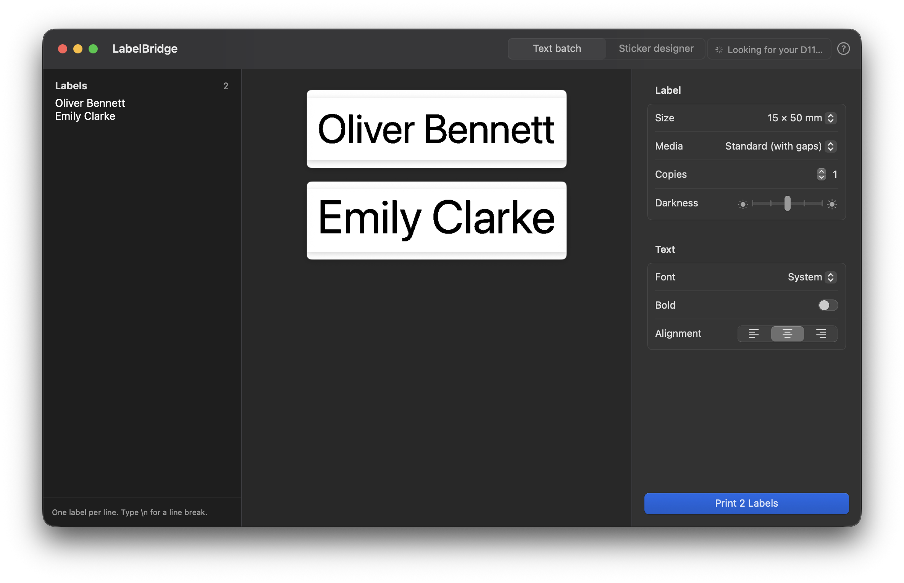
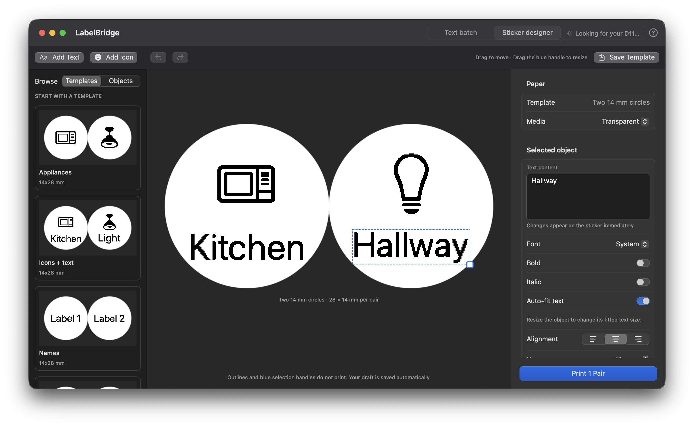

# LabelBridge


Print labels from your Mac to a **NIIMBOT D11 or D110** label printer **over Bluetooth**. NIIMBOT printers normally work only with the NIIMBOT phone app.

- **Batch labels:** paste a list, such as names, and get one label per line. Each label's text is sized to fill the label.
- **Any language:** Hebrew, Arabic and other right-to-left scripts, mixed-direction text, CJK and emoji.
- **Sticker designer:** paired 14 mm circles and rectangular labels with text and icons, templates, and exact millimetre positions.
- **Command line for AI agents and scripts:** `labelbridge print "Oliver" "Emily"`, or stickers from your templates with `labelbridge sticker print "Names" --text "Oliver" --text "Emily"`.
- **Any app's Print dialog:** a printer called **NIIMBOT D11 (Bluetooth)** with label paper sizes.

## Install

1. Download **LabelBridge.dmg** from the [latest release](../../releases/latest), open it, and drag **LabelBridge** to **Applications**.
2. Open LabelBridge and click **Start Setup**. Setup:
   - moves the app to Applications if needed,
   - asks for Bluetooth access,
   - adds the printer **NIIMBOT D11 (Bluetooth)**,
   - installs the `labelbridge` command in `/usr/local/bin`. macOS asks for your password.
3. Turn the D11 on and disconnect the NIIMBOT phone app. The printer accepts only one Bluetooth connection at a time. LabelBridge shows **Ready to print** when it sees the printer.

Requires macOS 13 or later, on Apple Silicon or Intel. LabelBridge is signed and notarized by Apple.

**Updates:** choose LabelBridge › Check for Updates…. LabelBridge also checks this repo's GitHub releases once a day and tells you when a new version is out. Nothing else is sent. You can turn this off in LabelBridge › Settings.

## Print from the window

<p align="center"></p>

Type or paste labels on the left, one per line. The middle shows a preview of each label at its real proportions. On the right you choose:
- the label size,
- the media (standard labels with gaps, or transparent),
- copies,
- darkness,
- the font, bold and alignment.

Then click **Print** (⌘P). To put a line break inside a label, type `\n`.

## Design circular stickers and icon labels

Choose **Sticker designer** at the top of the window:

<p align="center"></p>

1. Pick a template: **Appliances**, **Icons + text**, **Names**, **Blank circles**, or **Blank rectangle**.
2. Use **Add Text** and **Add Icon** to add as many objects as needed. The icon library includes household appliances, lights and common symbols.
3. Click an object to select it. Drag it to move it, or drag its blue bottom-right handle to resize it. The inspector also provides exact X, Y, width and height in millimetres.
4. For text objects, edit the words in **Text content** on the right. Choose a font, bold, italic and alignment. Keep **Auto-fit text** on to fit the object, or turn it off to choose an exact **Font size** in physical points (1–72 pt). Oversized text produces a preview warning.
5. Choose **Transparent** for your transparent roll, set copies and print. **Print 1 Pair** prints one feed unit containing both circles.

The circular template is two **14 mm circles** on a **14 × 28 mm** feed unit. Either circle can contain multiple independent text and icon objects, or remain blank. Circle outlines and selection handles are preview-only. The D110's print band is about 12 mm wide; the preview shows the actual printable ink and warns when content is clipped or text does not fit.

The current draft is saved automatically on this Mac. **Save Template** adds a named design to **My Templates**, ready to reuse, also from the command line (see [Print stickers from the command line](#print-stickers-from-the-command-line)). Undo and redo cover template changes, object edits, moves and resizing. The original one-label-per-line workflow remains under **Text batch**. Print-dialog jobs always print as text-batch labels.

**Alignment:** to check where your printer puts ink on a sticker roll, click **Print Alignment Test** under **Alignment** in the inspector. For paired circles, it prints a ring and a cross in the middle of each circle, with a dot marking the left one. If they're off-centre, set **Move right** or **Move down** (in mm; negative values move left or up) and test again. The offset applies to every sticker printed, from the window and from the command line.

## Print from the command line

```sh
labelbridge print "Oliver" "Emily" "محمد"         # one label per argument
labelbridge print --file names.txt                # one label per line
cat names.txt | labelbridge print -               # from stdin
labelbridge print "Spices\nTop shelf"             # two lines on one label
labelbridge print --copies 2 --density 4 --bold --font "Arial Hebrew" "Oliver"
labelbridge print --size 14x28 --media transparent "Spices"
labelbridge print --json "Oliver"                 # {"ok":true,"printed":1,"total":1,...}
labelbridge print --dry-run --file names.txt      # render only, don't print
labelbridge preview "Oliver" --out /tmp/labels    # write PNGs, no printer needed
labelbridge status                                # app and printer status
labelbridge sizes                                 # built-in label sizes
```

### Print stickers from the command line

`labelbridge sticker` prints sticker designs: a built-in or saved template (by name or id), `draft` for the design open in the designer, or a `.json` design file. `--text` replaces the design's text objects in order, so one template prints any names or captions.

```sh
labelbridge sticker list                                    # templates, your saved ones, and the draft
labelbridge sticker print "Names" --text "Oliver" --text "Emily"
labelbridge sticker print "Icons + text" --text "Kitchen" --text "Hallway" --media transparent
labelbridge sticker print draft --copies 3                  # two-circle designs: one copy = one pair
labelbridge sticker print --json --dry-run "Names" --text "Oliver"
labelbridge sticker preview "Names" --text "Oliver" --out /tmp/stickers   # PNG, no printer needed
labelbridge sticker export "Icons + text" --out kitchen.json               # edit, then:
labelbridge sticker print kitchen.json
labelbridge sticker icons                                   # icon names for design files
labelbridge sticker alignment                               # alignment test print
```

A design file lists objects with millimetre positions from the label's top-left corner:

```json
{
  "size": { "widthMM": 14, "lengthMM": 28 },
  "shape": "twoCircles",
  "objects": [
    { "content": { "icon": "lightbulb" }, "frame": { "x": 3, "y": 2, "width": 8, "height": 6 } },
    { "content": { "text": "Hallway" }, "frame": { "x": 16, "y": 9, "width": 10, "height": 3 },
      "style": { "bold": true } }
  ]
}
```

`style` is optional: `fontName`, `bold`, `italic`, `alignment` (`center`, `leading`, `trailing`) and `fontSizePoints` (1–72; leave it out to fit the text to its object). `shape` is `twoCircles` (14 × 28 mm) or `rectangle`.

### Options for `print` and `preview`

| Option | Default | Meaning |
|---|---|---|
| `--size 15x50` | the app's setting (15×50) | label size in mm |
| `--density 1-5` | 3 | darkness |
| `--media gaps\|transparent` | the app's setting (gaps initially) | label material/sensor mode |
| `--copies N` | 1 | copies of each label |
| `--align center\|leading\|trailing` | center | leading means the start of the line, which is the right side for Hebrew and Arabic |
| `--font "<family>"` | system font | any installed font family |
| `--bold` | off | bold text |

**Exit codes:**
- `0` printed
- `2` bad input
- `3` printer not found or busy
- `4` printing failed, for example the printer stopped answering (the JSON output says how many labels printed)
- `5` LabelBridge.app not available

The command talks to LabelBridge.app, which owns the Bluetooth connection. If the app isn't running, the command opens it in the background.

<details>
<summary><b>Full command reference</b> (<code>labelbridge --help</code>)</summary>

```text
OVERVIEW: Print labels to a NIIMBOT Bluetooth label printer through
LabelBridge.app.

One label per argument, or one per line with --file or stdin (-). Type \n
inside a label for a line break. Any language works, including Hebrew and
Arabic. Defaults (size, media, darkness, font, alignment) come from the app's
window.

EXAMPLES:
  labelbridge print "Dana" "Yossi" "محمد"
  labelbridge print --file names.txt --copies 2
  cat names.txt | labelbridge print -
  labelbridge print --json "Spices\nTop shelf"
  labelbridge preview "Dana" --out /tmp/labels

STICKERS (designs from the app's sticker designer):
  labelbridge sticker list
  labelbridge sticker print "Names" --text "Dana" --text "Yossi"
  labelbridge sticker print draft --copies 2
  See `labelbridge help sticker`.

FOR AI AGENTS:
  Add to the agent's instructions:
  "To print labels, run `labelbridge print --json`
   with one label per argument. For stickers, run
   `labelbridge sticker list`, then
   `labelbridge sticker print --json TEMPLATE --text …`."

EXIT CODES:
  0  printed
  2  bad input
  3  printer off, asleep, or busy (phone app connected)
  4  printing failed (the JSON says how many labels printed)
  5  LabelBridge.app not available

USAGE: labelbridge <subcommand>

OPTIONS:
  -h, --help              Show help information.

SUBCOMMANDS:
  print (default)         Print labels (default command).
  preview                 Write label images (PNG) without printing.
  sticker                 Print sticker designs: templates, the designer's
                          draft, or a .json design file.
  status                  Show whether LabelBridge.app and the printer are
                          available.
  sizes                   List built-in label sizes (width x length, mm).

  See 'labelbridge help <subcommand>' for detailed help.

────────

OVERVIEW: Print labels (default command).

Prints one label per item and waits until they're done. Progress goes to
stderr. With --json, prints {"ok", "printed", "total", "skipped", "warnings",
"error"} to stdout. Blank lines are skipped. Text that doesn't fit is shortened
with "…" and reported as a warning.

USAGE: labelbridge print [<items> ...] [--file <file>] [--size <size>] [--density <density>] [--media <media>] [--copies <copies>] [--align <align>] [--font <font>] [--bold] [--dry-run] [--json]

ARGUMENTS:
  <items>                 Label texts. Use - to read lines from stdin.

OPTIONS:
  -f, --file <file>       Read labels from a file, one per line.
  --size <size>           Label size in mm, width x length, e.g. 15x50 (see
                          `labelbridge sizes`).
  --density <density>     Darkness 1–5 (default 3).
  --media <media>         Label media: gaps or transparent (default: the app's
                          setting).
  --copies <copies>       Copies of each label. (default: 1)
  --align <align>         center, leading or trailing. Leading is the start of
                          the line: the right side for Hebrew and Arabic.
  --font <font>           Font family name, e.g. "Arial Hebrew".
  --bold                  Bold text.
  --dry-run               Render only; don't print.
  --json                  Print the result as JSON.
  -h, --help              Show help information.


────────

OVERVIEW: Write label images (PNG) without printing.

USAGE: labelbridge preview [<items> ...] [--file <file>] [--size <size>] [--density <density>] [--media <media>] [--copies <copies>] [--align <align>] [--font <font>] [--bold] [--out <out>]

ARGUMENTS:
  <items>                 Label texts. Use - to read lines from stdin.

OPTIONS:
  -f, --file <file>       Read labels from a file, one per line.
  --size <size>           Label size in mm, width x length, e.g. 15x50 (see
                          `labelbridge sizes`).
  --density <density>     Darkness 1–5 (default 3).
  --media <media>         Label media: gaps or transparent (default: the app's
                          setting).
  --copies <copies>       Copies of each label. (default: 1)
  --align <align>         center, leading or trailing. Leading is the start of
                          the line: the right side for Hebrew and Arabic.
  --font <font>           Font family name, e.g. "Arial Hebrew".
  --bold                  Bold text.
  --out <out>             Output directory. (default: .)
  -h, --help              Show help information.


────────

OVERVIEW: Print sticker designs: templates, the designer's draft, or a .json
design file.

A DESIGN is a template name or id (`labelbridge sticker list`), `draft` for the
design open in the app's sticker designer, or the path of a .json design file
(`labelbridge sticker export` writes one to start from). Use --text to fill the
design's text objects in order, for example the two circles of the "Names"
template.

EXAMPLES:
  labelbridge sticker list
  labelbridge sticker print "Names" --text "Dana" --text "Yossi"
  labelbridge sticker print "Icons + text" --text "Oven" --text "Hall" --media
transparent
  labelbridge sticker print draft --copies 3
  labelbridge sticker preview "Names" --text "Dana" --text "Yossi" --out
/tmp/stickers
  labelbridge sticker export "Icons + text" --out kitchen.json
  labelbridge sticker print kitchen.json --json
  labelbridge sticker alignment --media transparent

USAGE: labelbridge sticker <subcommand>

OPTIONS:
  -h, --help              Show help information.

SUBCOMMANDS:
  list                    List sticker templates and the designer's draft.
  print                   Print a sticker design.
  preview                 Write a sticker design as a PNG without printing.
  export                  Write a design as JSON, to edit and print with
                          `sticker print FILE`.
  icons                   List the icons a design can use.
  alignment               Print an alignment test to check where ink lands on a
                          sticker roll.

  See 'labelbridge help sticker <subcommand>' for detailed help.

────────

OVERVIEW: Print a sticker design.

Prints the design --copies times and waits until done. For the two-circle
templates, one copy is one pair. With --json, prints {"ok", "printed", "total",
"warnings", "error"} to stdout. Exit codes are the same as `labelbridge print`.
The app's print offset (sticker designer › Alignment) is applied.

USAGE: labelbridge sticker print <design> [--text <text> ...] [--copies <copies>] [--density <density>] [--media <media>] [--dry-run] [--json]

ARGUMENTS:
  <design>                Template name or id, `draft`, or a .json design file.

OPTIONS:
  -t, --text <text>       Text for the design's text objects, in order. Repeat
                          for each one; \n breaks a line.
  --copies <copies>       Copies (pairs, for two-circle designs). (default: 1)
  --density <density>     Darkness 1–5 (default: the app's setting).
  --media <media>         Label media: gaps or transparent (default: the app's
                          setting).
  --dry-run               Render only; don't print.
  --json                  Print the result as JSON.
  -h, --help              Show help information.


────────

OVERVIEW: Write a design as JSON, to edit and print with `sticker print FILE`.

Sizes and positions are millimetres from the label's top-left corner; size is
{widthMM, lengthMM}. Each object is {"content": {"text": "…"} or {"icon": "…"},
"frame": {x, y, width, height}, "style": {…}}. "id" and "style" may be left
out. Style: fontName, bold, italic, alignment (center, leading, trailing),
fontSizePoints (1–72; leave out to fit the object). Shape "twoCircles" needs
size 14x28.

USAGE: labelbridge sticker export <design> [--text <text> ...] [--out <out>]

ARGUMENTS:
  <design>                Template name or id, `draft`, or a .json design file.

OPTIONS:
  -t, --text <text>       Text for the design's text objects, in order. Repeat
                          for each one; \n breaks a line.
  --out <out>             Output file (default: stdout).
  -h, --help              Show help information.


────────

OVERVIEW: Show whether LabelBridge.app and the printer are available.

USAGE: labelbridge status [--json]

OPTIONS:
  --json                  Print as JSON.
  -h, --help              Show help information.
```

</details>

### Instructions for AI agents

Add this to your agent's instructions (for example `CLAUDE.md`). It's also in the app under Help › AI Agents, with a Copy button:

```text
To print labels on my NIIMBOT label printer, use the `labelbridge` command:
- Text labels: `labelbridge print --json "First label" "Second label"` (one label per argument; \n inside a label breaks the line).
- Stickers: run `labelbridge sticker list` to see the templates, then `labelbridge sticker print --json "TEMPLATE" --text "…" --text "…"`. Each --text fills the template's next text object; for two-circle templates each copy is one pair of circles.
- Check first without printing: add `--dry-run`. Preview as PNG: `labelbridge preview …` or `labelbridge sticker preview … --out DIR`.
- Run `labelbridge help sticker` for design files and more options.
```

Design a sticker once in the app and save it with **Save Template**; the agent can then print it by name with different text.

The agent's shell must be able to reach `~/Library/Application Support/LabelBridge/` and launch apps. Some sandboxed agent shells block this. You'll then see exit code `5`. Allow that folder, or run the command outside the sandbox.

## Print from any app

Choose **NIIMBOT D11 (Bluetooth)** in the Print dialog and pick a label size under **Paper Size**. Each page becomes one label, fitted and centred. LabelBridge must be running. Turn on **Open at login** in LabelBridge › Settings if you want the Print dialog to work without opening the app first.

## Label sizes

- Built in, width × length in mm: 15×50 (default), 12×40, 14×40, 15×30, 12×22, 14×22, 15×40 and 14×28.
- For **TT14×28-220 transparent** rolls, select **14 × 28 mm** and **Media: Transparent** in the window. The “220” is the label count. The CLI uses these saved settings, or you can pass `--size 14x28 --media transparent`. Print-dialog jobs use the window's Media setting; choose 14 × 28 mm as their Paper Size. Existing installations need **Settings › Repair Setup** to refresh the Print-dialog paper sizes.
- Any other size: pass `--size WxL`.
- The D11's print head is 12 mm wide. On wider labels, the print stays in the 12 mm band in the middle.
- The original D110 is selected automatically by its Bluetooth name (`D110-…`), using its legacy protocol, 203 dpi and 96-dot head. Darkness values above 3 use the D110's maximum of 3. Previews use the D11_H canvas and are resized for the D110 when printing.
- LabelBridge leaves 2 mm empty at each end of the label so nothing gets cut off.

## Troubleshooting

- **"Looking for your D11…" or exit code 3:** the printer is off, asleep or out of range, or the NIIMBOT phone app is connected to it. Close the app or turn off Bluetooth on the phone, then turn the printer on.
- **The printer's light turns red and printing stops:** the printer found a problem, usually labels not seated, so it can't find the next label, or the lid not fully closed. LabelBridge shows the printer's reason. Open the lid, reseat the roll, close it firmly, and turn the printer off and on if the light stays red.
- **Bluetooth access needed:** allow LabelBridge in System Settings › Privacy & Security › Bluetooth.
- **Text looks too light:** raise the darkness.
- **Logs:** `~/Library/Logs/LabelBridge.log`. Open them from Help › Open Log.
- **Stickers print off-centre:** print an alignment test (sticker designer › Alignment, or `labelbridge sticker alignment`) and set the offset.
- **More help:** Help › LabelBridge Help (⌘?) in the app covers printing, stickers, the command line, AI agents and troubleshooting.
- **Repair or uninstall:** LabelBridge › Settings.

## Supported printers

| Printer | Status |
|---|---|
| NIIMBOT D11_H | tested |
| NIIMBOT D110 | tested with the legacy protocol and 203 dpi, 96-dot head |
| NIIMBOT D11, D11 Pro, D110_M | untested; may work if they use the same protocol |

## Build from source

```sh
swift test
scripts/dev-bundle.sh                                   # debug app in build/dev/
SIGN_ID="Developer ID Application: …" scripts/build.sh  # universal release build in build/
scripts/make-dmg.sh
NOTARY_PROFILE=<profile> scripts/notarize.sh            # or ASC_KEY_PATH / ASC_KEY_ID / ASC_ISSUER_ID
```

Without `SIGN_ID`, the app is signed ad hoc. macOS then asks for Bluetooth access again after every build.

The Bluetooth protocol is described in [docs/PROTOCOL.md](docs/PROTOCOL.md).

## Credits

- The NIIMBOT protocol details come from [MultiMote/niimbluelib](https://github.com/MultiMote/niimbluelib) (MIT).
- See also [PeriPage Bridge](https://github.com/hayek/peripage-bridge), which prints to a PeriPage P81 from a Mac over Bluetooth.

This is an independent project and is not affiliated with NIIMBOT. MIT licensed.
